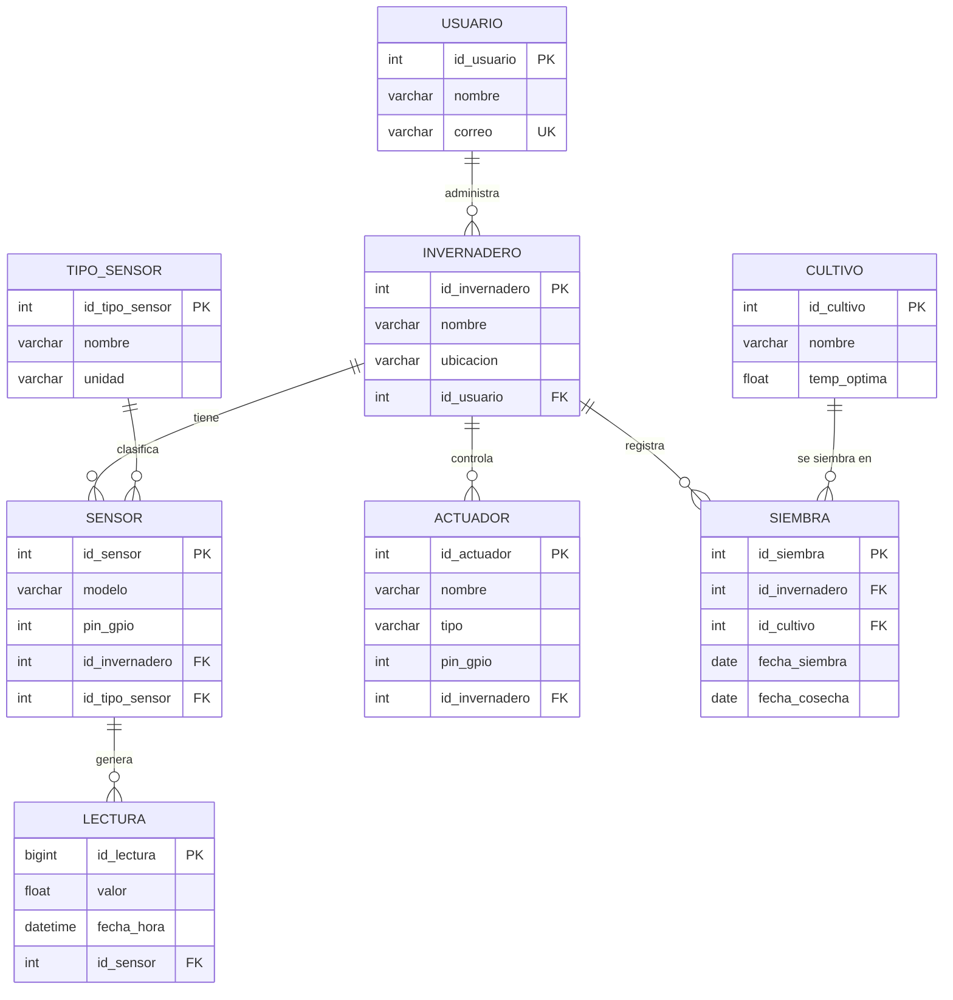

# Semana 6 · ERD de mi caso

**Estudiante:** Cristian Camilo Quiguanas Ossa
**Programa:** Ingeniería Mecatrónica · Corhuila
**Asignatura:** Ciencia de Datos · Periodo 2026-B · Unidad 2, Semana 6

---

## 1. Mi caso: Invernadero inteligente con ESP32

Un sistema de monitoreo y control de invernaderos. Cada invernadero tiene sensores (temperatura NTC, luz LDR, humedad, etc.) conectados a un ESP32 que envía lecturas periódicas, y actuadores (lámpara de cultivo, ventilador, bomba de riego). Un usuario puede administrar varios invernaderos, y en cada invernadero se pueden sembrar varios cultivos a lo largo del tiempo (y un mismo cultivo se siembra en varios invernaderos).

### Entidades

| Entidad | Descripción |
|---|---|
| `USUARIO` | Persona que administra uno o más invernaderos |
| `INVERNADERO` | Espacio físico monitoreado |
| `TIPO_SENSOR` | Catálogo de tipos de sensor (NTC, LDR, humedad...) con su unidad |
| `SENSOR` | Sensor instalado en un invernadero |
| `LECTURA` | Medición tomada por un sensor en un instante |
| `ACTUADOR` | Dispositivo controlado (lámpara, ventilador, bomba) |
| `CULTIVO` | Catálogo de cultivos (tomate, lechuga, etc.) |
| `SIEMBRA` | **Tabla intermedia** de la relación N:M entre `INVERNADERO` y `CULTIVO` |

### Diagrama ERD



### Relaciones, PK y FK

| Relación | Cardinalidad | Llave foránea |
|---|---|---|
| USUARIO → INVERNADERO | 1:N | `INVERNADERO.id_usuario` |
| INVERNADERO → SENSOR | 1:N | `SENSOR.id_invernadero` |
| TIPO_SENSOR → SENSOR | 1:N | `SENSOR.id_tipo_sensor` |
| SENSOR → LECTURA | 1:N | `LECTURA.id_sensor` |
| INVERNADERO → ACTUADOR | 1:N | `ACTUADOR.id_invernadero` |
| **INVERNADERO ↔ CULTIVO** | **N:M** | `SIEMBRA.id_invernadero` y `SIEMBRA.id_cultivo` |

**Relación N:M:** un invernadero puede tener muchos cultivos (en distintas siembras) y un cultivo puede sembrarse en muchos invernaderos. Se resuelve con la tabla intermedia `SIEMBRA`, que además guarda atributos propios de la relación (`fecha_siembra`, `fecha_cosecha`). Se agrega `id_siembra` como PK para permitir sembrar el mismo cultivo en el mismo invernadero en fechas distintas.

### Script SQL de referencia

```sql
CREATE TABLE usuario (
    id_usuario   INT PRIMARY KEY,
    nombre       VARCHAR(100) NOT NULL,
    correo       VARCHAR(120) UNIQUE NOT NULL
);

CREATE TABLE invernadero (
    id_invernadero INT PRIMARY KEY,
    nombre         VARCHAR(100) NOT NULL,
    ubicacion      VARCHAR(150),
    id_usuario     INT NOT NULL REFERENCES usuario(id_usuario)
);

CREATE TABLE tipo_sensor (
    id_tipo_sensor INT PRIMARY KEY,
    nombre         VARCHAR(50) NOT NULL,   -- NTC, LDR, humedad
    unidad         VARCHAR(20) NOT NULL    -- °C, lux, %
);

CREATE TABLE sensor (
    id_sensor      INT PRIMARY KEY,
    modelo         VARCHAR(50),
    pin_gpio       INT,
    id_invernadero INT NOT NULL REFERENCES invernadero(id_invernadero),
    id_tipo_sensor INT NOT NULL REFERENCES tipo_sensor(id_tipo_sensor)
);

CREATE TABLE lectura (
    id_lectura BIGINT PRIMARY KEY,
    valor      FLOAT NOT NULL,
    fecha_hora DATETIME NOT NULL,
    id_sensor  INT NOT NULL REFERENCES sensor(id_sensor)
);

CREATE TABLE actuador (
    id_actuador    INT PRIMARY KEY,
    nombre         VARCHAR(50) NOT NULL,
    tipo           VARCHAR(30),            -- lámpara, ventilador, bomba
    pin_gpio       INT,
    id_invernadero INT NOT NULL REFERENCES invernadero(id_invernadero)
);

CREATE TABLE cultivo (
    id_cultivo  INT PRIMARY KEY,
    nombre      VARCHAR(80) NOT NULL,
    temp_optima FLOAT
);

-- Tabla intermedia de la relación N:M
CREATE TABLE siembra (
    id_siembra     INT PRIMARY KEY,
    id_invernadero INT NOT NULL REFERENCES invernadero(id_invernadero),
    id_cultivo     INT NOT NULL REFERENCES cultivo(id_cultivo),
    fecha_siembra  DATE NOT NULL,
    fecha_cosecha  DATE
);
```

---

## 2. ¿Relacional o NoSQL?

**Decisión: modelo relacional** (por ejemplo PostgreSQL, MySQL o SQLite).

**Por qué:**

1. **Los datos están fuertemente relacionados.** Usuario → invernadero → sensor → lectura, y la relación N:M entre invernaderos y cultivos. Los `JOIN` y las llaves foráneas expresan esto de forma natural.
2. **Esquema estable y bien definido.** Una lectura siempre tiene sensor, valor y fecha. No hay estructuras cambiantes que justifiquen un modelo flexible de documentos.
3. **Integridad referencial.** No debe existir una lectura de un sensor inexistente ni un sensor sin invernadero; las FK y restricciones lo garantizan.
4. **Consultas analíticas con SQL.** Promedios de temperatura por día, máximos de luz por invernadero o comparación entre cultivos son consultas con `GROUP BY` y `JOIN`, directas en SQL.
5. **Escala moderada.** Un ESP32 enviando una lectura cada minuto genera pocos miles de filas por día, lo que un motor relacional maneja sin problema.

**Cuándo cambiaría de opinión:** si el sistema creciera a cientos de invernaderos con lecturas por segundo, evaluaría una base de series de tiempo (InfluxDB o TimescaleDB) o NoSQL (MongoDB) solo para la tabla `LECTURA`, manteniendo el resto en relacional (enfoque híbrido). Para este caso no es necesario.

---

## 3. Normalización aplicada

| Forma normal | Qué se aplicó | Qué se evitó repetir |
|---|---|---|
| **1FN** | Todos los campos son atómicos; no hay listas ni campos repetidos (por ejemplo, no existe `lectura1, lectura2, lectura3` en `SENSOR`). | Grupos de columnas repetidas. Cada medición es una fila en `LECTURA`. |
| **2FN** | En `SIEMBRA`, los atributos `fecha_siembra` y `fecha_cosecha` dependen de la siembra completa (invernadero + cultivo), no de una sola parte. Los datos propios del cultivo (`nombre`, `temp_optima`) están en `CULTIVO`. | Repetir el nombre y la temperatura óptima del cultivo en cada siembra. |
| **3FN** | `unidad` depende del tipo de sensor, no del sensor: se movió a `TIPO_SENSOR`. Los datos del usuario (`nombre`, `correo`) están en `USUARIO`, no en `INVERNADERO`. | Repetir "°C" o "lux" en cada sensor y repetir nombre/correo del dueño en cada invernadero. |

**Ejemplo concreto:** si la unidad estuviera en `SENSOR`, cada sensor de temperatura repetiría "°C"; un error de escritura ("C°", "celsius") rompería la consistencia. Con `TIPO_SENSOR`, la unidad se guarda una sola vez y se cambia en un solo lugar.

