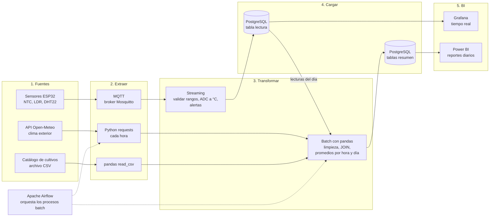

# Semana 8 · Pipeline ETL

**Estudiante:** Cristian Camilo Quiguanas Ossa
**Programa:** Ingeniería Mecatrónica · Corhuila
**Asignatura:** Ciencia de Datos · Periodo 2026-B · Unidad 2, Semana 8

---

## 1. Mi caso: invernadero inteligente con ESP32

Es el mismo caso de las semanas 6 y 7. Los sensores del invernadero (temperatura, luz y humedad) generan lecturas continuas que se guardan en la base de datos relacional diseñada en la Semana 6 (`invernadero`, `sensor`, `lectura`, etc.). Además, se consulta el clima exterior de una API pública para compararlo con lo que ocurre dentro del invernadero. El objetivo del pipeline es llevar esos datos desde su origen hasta tableros de BI.

## 2. Diagrama del pipeline



> Las líneas continuas son el flujo de datos. La línea punteada indica que Airflow programa y supervisa los procesos batch.

## 3. Herramienta por etapa

| Etapa | Qué se hace | Herramienta | Modo |
|---|---|---|---|
| **Fuentes** | Lecturas de temperatura (NTC), luz (LDR) y humedad (DHT22) | ESP32 con MicroPython | Continuo |
| **Fuentes** | Clima exterior (temperatura y humedad por hora) | API pública Open-Meteo | Periódico |
| **Fuentes** | Datos maestros de cultivos y rangos óptimos | Archivo CSV | Estático |
| **Extraer** | El ESP32 publica cada lectura en un tópico | MQTT con broker Mosquitto | Streaming |
| **Extraer** | Se consulta la API una vez por hora | Python `requests` | Batch |
| **Extraer** | Se lee el catálogo | pandas `read_csv` | Batch |
| **Transformar** | Validar rangos, convertir el valor ADC a °C y disparar alertas | Python (suscriptor MQTT) | Streaming |
| **Transformar** | Limpiar duplicados y nulos, cruzar con clima y cultivo, calcular promedios por hora y día | pandas | Batch |
| **Cargar** | Guardar las lecturas validadas en la tabla `lectura` | PostgreSQL | Streaming |
| **Cargar** | Guardar los resúmenes horarios y diarios | PostgreSQL | Batch |
| **BI** | Monitoreo en vivo de temperatura, luz y humedad | Grafana | Tiempo real |
| **BI** | Reportes históricos y comparación entre invernaderos | Power BI | Diario |
| **Orquestación** | Programar y reintentar los procesos batch | Apache Airflow | Batch |

---

## 4. ¿Qué es batch y qué es streaming?

### Streaming (flujo continuo de eventos)

| Parte | Por qué es streaming |
|---|---|
| Ingesta de lecturas de los sensores por MQTT | Los datos llegan continuamente, cada pocos segundos, y se necesitan apenas se generan. |
| Validación y conversión ADC a °C | Es un cálculo simple por evento y no necesita esperar a otros datos. |
| Alertas y control (lámpara, ventilador, bomba) | Si la temperatura pasa de 30 °C hay que reaccionar en segundos. Esperar a un proceso nocturno sería inútil para proteger el cultivo. |
| Tablero en vivo en Grafana | Muestra el estado actual del invernadero. |

### Batch (procesos por lotes programados)

| Parte | Por qué es batch |
|---|---|
| Consulta a la API de clima | El clima exterior cambia por hora, no por segundo. Además, las APIs públicas limitan las consultas, así que una vez por hora es suficiente. |
| Lectura del catálogo de cultivos | Casi no cambia; basta recargarlo cuando se modifica. |
| Limpieza y agregaciones (promedios, mínimos, máximos por hora y día) | Se calculan sobre muchos registros a la vez y no hay urgencia por el resultado. |
| Reportes en Power BI | Se consultan una vez al día o a la semana para tomar decisiones de manejo del cultivo. |

### Resumen de la decisión

Los datos que **piden una reacción inmediata** (sensores y alertas) van en **streaming**. Los datos que **sirven para analizar y reportar** (clima, resúmenes, histórico) van en **batch**, que es más simple, más barato y más fácil de reintentar si algo falla. Esta combinación de ambos enfoques se conoce como arquitectura híbrida.

---

## 5. Consumo de una API pública con `requests` (opcional)

Para la etapa de **extracción batch** del clima exterior, el script `consumir_api.py` consulta la API pública **Open-Meteo**, que no requiere API key. Hace la **E** (extraer con `requests`) y parte de la **T** (renombrar columnas y convertir tipos con pandas), y muestra 3 registros.

```python
import requests
import pandas as pd

URL = "https://api.open-meteo.com/v1/forecast"
PARAMS = {
    "latitude": 2.93,        # ajusta a la ubicación de tu invernadero
    "longitude": -75.28,
    "hourly": "temperature_2m,relative_humidity_2m",
    "forecast_days": 1,
    "timezone": "America/Bogota",
}

respuesta = requests.get(URL, params=PARAMS, timeout=15)
respuesta.raise_for_status()
datos = respuesta.json()

df = pd.DataFrame(datos["hourly"]).rename(columns={
    "time": "fecha_hora",
    "temperature_2m": "temperatura_c",
    "relative_humidity_2m": "humedad_pct",
})
df["fecha_hora"] = pd.to_datetime(df["fecha_hora"])
print(df.head(3))
```

**Cómo ejecutarlo:**

```bash
pip install -r requirements.txt
python consumir_api.py
```

**Formato de la salida** (los valores son ilustrativos y cambian con el pronóstico de cada día):

```
Registros recibidos: 24

Primeros 3 registros:
         fecha_hora  temperatura_c  humedad_pct
2026-10-14 00:00:00           19.1           88
2026-10-14 01:00:00           18.8           89
2026-10-14 02:00:00           18.5           90
```

La API devuelve 24 registros (uno por hora del día) y el script muestra los primeros 3. Si no hay conexión a internet, el script termina con un mensaje de error claro en lugar de fallar con un traceback.

---

## Archivos de esta carpeta

| Archivo | Contenido |
|---|---|
| `README.md` | Diagrama del pipeline, herramientas, justificación batch/streaming y consumo de API |
| `consumir_api.py` | Script que consume la API y muestra 3 registros |
| `requirements.txt` | Dependencias (`requests`, `pandas`) |
