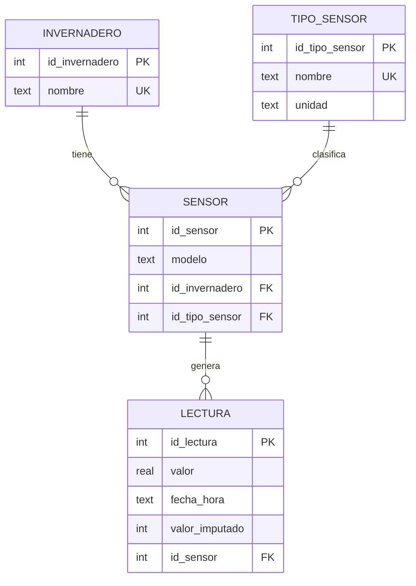
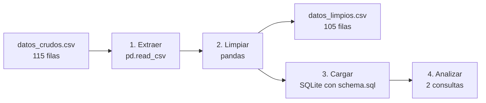

# Semana 10 · Mini-proyecto de datos (cierre del Corte 2)

**Estudiante:** Cristian Camilo Quiguanas Ossa
**Programa:** Ingeniería Mecatrónica · Corhuila
**Asignatura:** Ciencia de Datos · Periodo 2026-B · Unidad 2, Semana 10

---

## 1. Caso y objetivo

Integro lo del corte sobre el caso del **invernadero inteligente con ESP32** (semanas 6 a 9): partiendo de un CSV con lecturas de temperatura, luz y humedad, lo limpio con pandas, lo cargo en una base de datos con el modelo (ERD) y respondo 2 preguntas con consultas.

## 2. Archivos de esta carpeta

| Archivo | Contenido |
|---|---|
| `datos_crudos.csv` | Dataset de entrada, con problemas de calidad (115 filas) |
| `schema.sql` | Modelo de datos: las 4 tablas del ERD |
| `pipeline.py` | Flujo completo: extraer → limpiar → cargar → analizar |
| `datos_limpios.csv` | Datos limpios, listos para analizar (105 filas) |
| `README.md` | Este documento |

Para reproducir: `pip install pandas` y luego `python pipeline.py` desde esta carpeta. Con `python pipeline.py --db invernadero.db` también guarda la base SQLite en un archivo.

---

## 3. Modelo de datos (ERD)

Es un subconjunto del ERD de la Semana 6: se conservan las 4 tablas que necesita este análisis. A `lectura` le agregué el campo `valor_imputado`, para saber qué valores se rellenaron durante la limpieza.



El CSV llega "plano" (invernadero, sensor, variable y unidad repetidos en cada fila). Al cargarlo se reparte en las 4 tablas, de modo que el nombre del invernadero y la unidad se guardan una sola vez (normalización, como en la Semana 6).

---

## 4. Flujo documentado: extraer → limpiar → cargar → analizar



| Etapa | Qué hace | Herramienta |
|---|---|---|
| **1. Extraer** | Lee el CSV crudo | `pandas.read_csv` |
| **2. Limpiar** | Normaliza texto, corrige tipos, trata valores centinela y fuera de rango, elimina duplicados y resuelve faltantes | pandas |
| **3. Cargar** | Crea las 4 tablas con `schema.sql` y las llena a partir de los datos limpios | `sqlite3` |
| **4. Analizar** | Responde 2 preguntas con filtro + agregación (una en SQL y otra en pandas) | SQL y pandas |

### Problemas del dataset y cómo se resolvieron

| Problema | Tratamiento |
|---|---|
| Texto inconsistente (`Tomates`, `TOMATES`, ` tomates `; `temp`, `TEMPERATURA`) | `strip`, `title`/`lower` y un diccionario de sinónimos |
| `valor` con coma decimal (`28,4`), que vuelve la columna texto | Reemplazo de coma por punto y `to_numeric` |
| Fechas en dos formatos (`2026-10-14 08:00:00` y `14/10/2026 08:00`) y una `sin fecha` | `to_datetime` con cada formato; la fecha inválida queda como nula |
| Valor centinela `-999` | Se convierte en nulo |
| Valores fuera de rango físico (temperatura 85 °C, humedad 130 %, luz negativa) | Se convierten en nulos según un rango válido por variable |
| Duplicados, incluidos los que solo difieren en el formato del texto | `drop_duplicates()` **después** de normalizar |
| Sin invernadero o sin fecha válida | Se elimina la fila (no se puede ubicar la lectura) |
| Unidad faltante | Se deduce de la variable |
| Valor faltante | Se imputa con la mediana de su invernadero y variable, y se marca con `valor_imputado` |

### Evidencia antes / después

Salida real de `python pipeline.py`:

```
1) EXTRAER
   115 filas leídas de datos_crudos.csv
2) LIMPIAR
   Métrica                    Antes   Después
   Filas                        115       105
   Nulos (celdas)                15         0
   Duplicados (exactos)           5         0
   Valores imputados con la mediana: 15
3) CARGAR (SQLite, 4 tablas según el ERD)
   invernadero    2 filas
   tipo_sensor    3 filas
   sensor         6 filas
   lectura      105 filas
```

| Métrica | Antes | Después |
|---|---|---|
| Filas | 115 | 105 |
| Nulos (celdas) | 15 | 0 |
| Duplicados exactos | 5 | 0 |
| Valores imputados | 0 | 15 (marcados) |

**De dónde salen las 10 filas menos (115 → 105):** 7 duplicados eliminados (los 5 exactos y 2 que solo se detectaron después de normalizar el texto), 2 filas sin invernadero y 1 fila con la fecha `sin fecha`.

**Los 15 valores imputados** vienen de 6 celdas vacías, 3 `N/A`, 3 valores `-999` y 3 valores fuera de rango. Todos quedan marcados en `valor_imputado`, y los análisis de abajo los **excluyen** para no mezclar mediciones reales con valores rellenados.

---

## 5. Análisis con consultas

### Pregunta 1 (SQL): ¿cuántas lecturas de temperatura superaron los 30 °C, por invernadero y por día?

Sirve para ver cuándo hubo calor excesivo, que es lo que activaría un ventilador. Usa **filtro** (`WHERE`), **JOIN** a las tablas del modelo y **agregación** (`COUNT`, `MAX` con `GROUP BY`).

```sql
SELECT i.nombre              AS invernadero,
       date(l.fecha_hora)    AS dia,
       COUNT(*)              AS lecturas_sobre_30,
       ROUND(MAX(l.valor),1) AS maxima_c
FROM lectura l
JOIN sensor s      ON s.id_sensor = l.id_sensor
JOIN tipo_sensor t ON t.id_tipo_sensor = s.id_tipo_sensor
JOIN invernadero i ON i.id_invernadero = s.id_invernadero
WHERE t.nombre = 'Temperatura'
  AND l.valor > 30
  AND l.valor_imputado = 0
GROUP BY i.nombre, date(l.fecha_hora)
ORDER BY i.nombre, dia;
```

**Resultado:**

| invernadero | dia | lecturas_sobre_30 | maxima_c |
|---|---|---|---|
| Lechugas | 2026-10-16 | 1 | 31.5 |
| Tomates | 2026-10-14 | 2 | 31.5 |
| Tomates | 2026-10-15 | 2 | 32.4 |
| Tomates | 2026-10-16 | 4 | 34.2 |

**Interpretación:** el Invernadero Tomates superó los 30 °C los tres días, y cada vez con más lecturas (2, 2 y 4), con un máximo de 34.2 °C el 16 de octubre. El de Lechugas solo lo hizo una vez, ese mismo día. El 16 fue el día más caluroso en ambos, así que ese día convendría reforzar la ventilación, sobre todo en Tomates.

El script comprueba además que esta consulta da el mismo resultado que su versión en pandas (`¿Coincide con la versión en pandas? True`).

### Pregunta 2 (pandas): ¿cuánta luz recibe cada invernadero entre las 09:00 y las 15:00?

Sirve para comparar la luz disponible en las horas de más sol y decidir si hace falta lámpara de cultivo. Usa **filtro** (variable, franja horaria y sin valores imputados) y **agregación** (`groupby` con `count`, `mean` y `max`).

```python
filtro = (
    (df["variable"] == "Luz")
    & (df["fecha_hora"].dt.hour.between(9, 15))
    & (~df["valor_imputado"])
)
resultado = (
    df[filtro]
    .groupby("invernadero")["valor"]
    .agg(n_lecturas="count", luz_promedio="mean", luz_maxima="max")
    .round(1)
    .reset_index()
)
```

**Resultado:**

| invernadero | n_lecturas | luz_promedio (lux) | luz_maxima (lux) |
|---|---|---|---|
| Lechugas | 6 | 598.9 | 728.4 |
| Tomates | 8 | 755.0 | 893.3 |

**Interpretación:** en la franja de 09:00 a 15:00, el Invernadero Tomates recibe en promedio más luz (755 lux) que el de Lechugas (599 lux), unos 156 lux más. `n_lecturas` cuenta solo las lecturas reales de esa franja; las imputadas y las filas eliminadas en la limpieza no se incluyen.

---

## 6. Datos listos para analizar

`datos_limpios.csv` queda sin nulos ni duplicados, con tipos correctos (`valor` numérico, `fecha_hora` como fecha y hora) y un formato único de texto. La base SQLite con el modelo se reconstruye en segundos con `python pipeline.py --db invernadero.db`.
