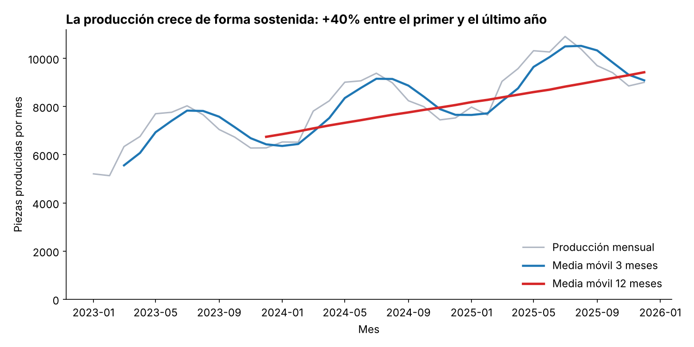
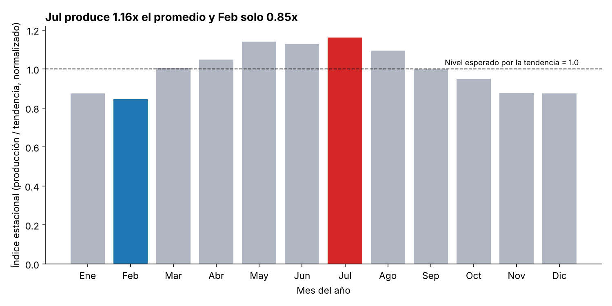

# c3-activity — Corte 3: Análisis temporal y visualización

**Estudiante:** Cristian Camilo Quiguanas Ossa · Ingeniería Mecatrónica · Electiva de Ciencia de Datos · Semana 14

**Caso:** producción diaria de piezas de una línea de manufactura automatizada (2023-2025), un indicador típico de monitoreo en mecatrónica e industria.

## Contenido
- `analysis.py`: carga la serie, `resample`, media móvil, gráficos y optimización SQL.
- `produccion.csv`: piezas producidas por día (datos sintéticos reproducibles con `seed=42`).
- `chart1_evolucion.png`, `chart2_estacionalidad.png`: visualizaciones.
- `optimizacion.sql`: consulta original vs. optimizada.

Ejecutar: `python analysis.py` (pandas, numpy, matplotlib).

## Metodología
1. Producción diaria agregada por mes con `resample("MS").sum()`.
2. Media móvil de 3 meses (corto plazo) y de 12 meses (tendencia sin estacionalidad).
3. Tendencia: regresión lineal sobre la serie mensual.
4. Estacionalidad: cada mes se divide entre su valor de tendencia y se promedia por mes del año (índice estacional), para que la estacionalidad no se mezcle con el crecimiento.

## Gráficos

## Interpretación (ES)
**Tendencia.** La producción mensual crece de forma sostenida: la pendiente es de ~109 piezas por mes y el último año produce ~40% más que el primero. La media móvil de 12 meses sube casi en línea recta, lo que indica una mejora estructural de la línea (más capacidad o mayor eficiencia) y no una fluctuación pasajera.

**Estacionalidad.** Cada año se repite el mismo patrón: la producción sube hacia mitad de año y alcanza su máximo en julio (1.16 veces lo esperado por la tendencia), y cae a su mínimo en febrero (0.85 veces). La media móvil de 3 meses sigue estas oscilaciones; la de 12 meses las suaviza porque abarca un ciclo completo.

**Gráficos.** El de evolución (línea) muestra la serie mensual con ambas medias móviles. El de comparación (barras) muestra el índice estacional por mes; la línea punteada en 1.0 es el nivel esperado según la tendencia. Ambos ejes parten de cero para no exagerar diferencias.

## Findings
The monthly output of the automated production line shows a clear upward trend: production grew about 40% between the first and the last year, with a linear slope of roughly 109 pieces per month. The 12-month moving average rises steadily and removes the seasonal swings, which makes the long-term improvement easy to see. The series also has strong seasonality, with July as the peak month (about 1.16 times the level expected from the trend) and February as the lowest (about 0.85 times). The first chart (line) shows monthly production together with the 3-month and 12-month moving averages, so the reader can compare short-term fluctuations against the long-term trend. The second chart (bars) shows the seasonal index for each month, highlighting the peak in red and the valley in blue against a dashed line that marks the trend-expected level. Both charts start their vertical axis at zero to avoid exaggerating differences. Finally, the SQL optimization (a range filter on the date column plus a covering index) changed the query plan from a full table scan to an index search and cut the execution time from about 78 ms to about 11 ms (roughly 7 times faster) on 300,000 records.

## Optimización SQL
**Problema.** La consulta calcula la producción por máquina en un año: `WHERE strftime('%Y', fecha) = '2025'`. Al aplicar una función a la columna `fecha`, el motor debe calcularla fila por fila y no puede usar un índice: hace un `SCAN` completo de la tabla.

**Paso 1 — Reescribir el filtro como rango (sargable):** `WHERE fecha >= '2025-01-01' AND fecha < '2026-01-01'`. Devuelve exactamente las mismas filas, pero deja la columna "limpia" para que un índice sirva.

**Paso 2 — Crear un índice cubridor:** `CREATE INDEX idx_prod_fecha_maq ON produccion(fecha, maquina_id, piezas)`. `fecha` va primero para el rango; `maquina_id` y `piezas` se incluyen para que la consulta se responda solo con el índice, sin leer la tabla.

**Paso 3 — Verificar con `EXPLAIN QUERY PLAN`:** antes `SCAN produccion`; después `SEARCH produccion USING COVERING INDEX idx_prod_fecha_maq (fecha>? AND fecha<?)`.

**Métrica:** ~78 ms → ~11 ms (≈ 7x más rápido) sobre 300.000 registros. Los tiempos varían según el equipo; el cambio de plan es lo que se mantiene. El costo es espacio extra en disco y escrituras un poco más lentas por mantener el índice.
