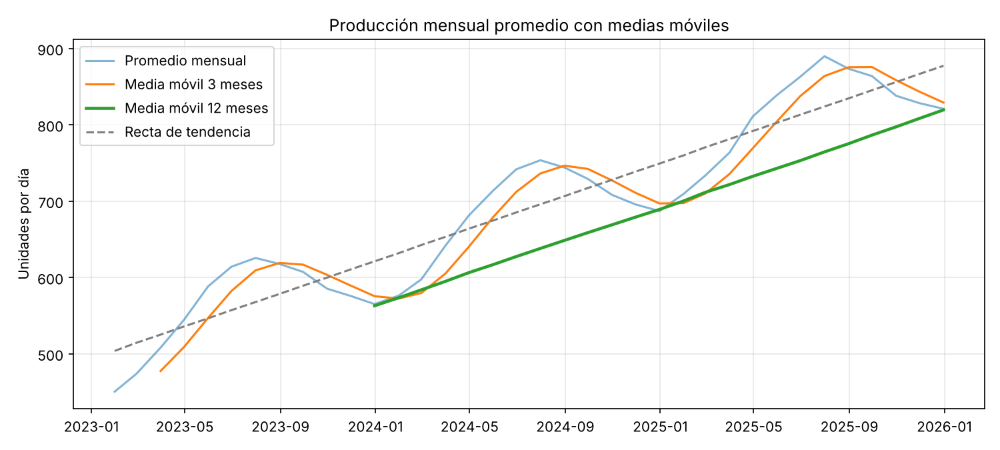
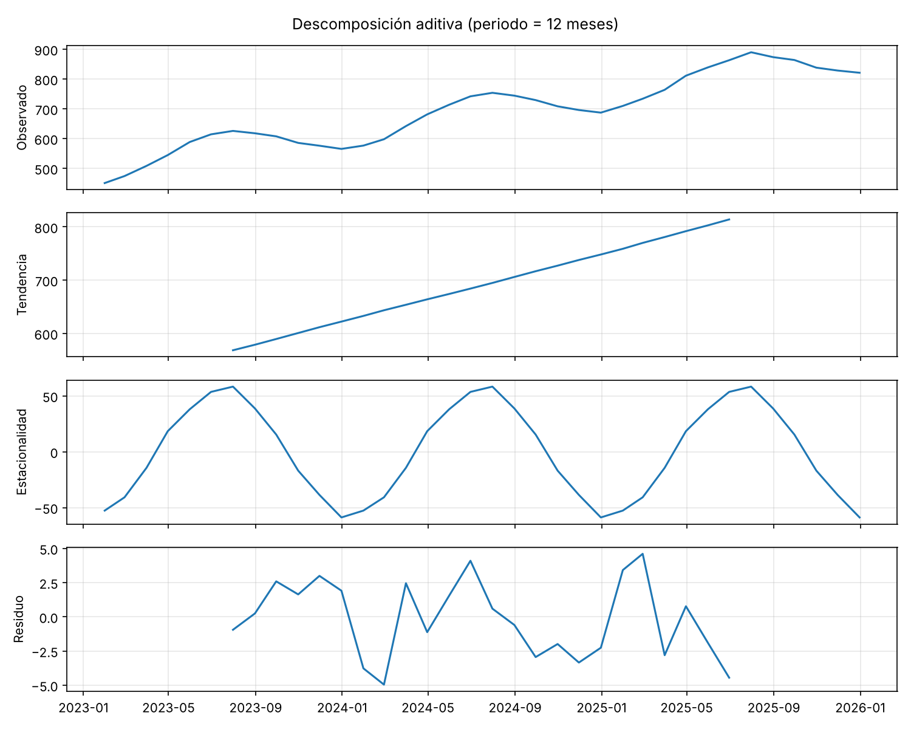
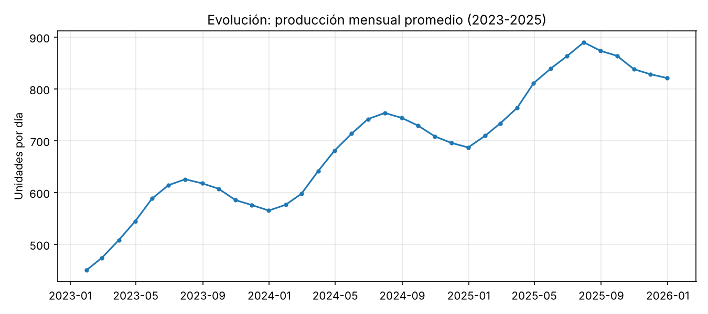
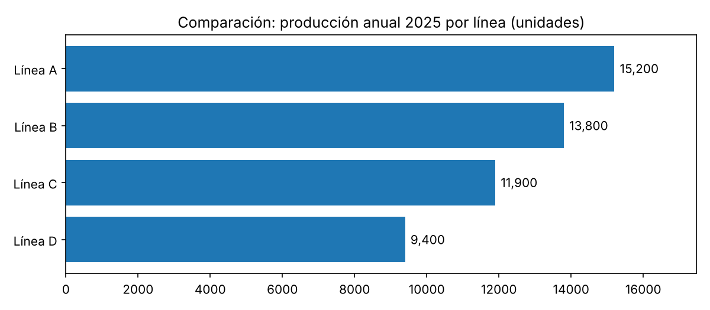
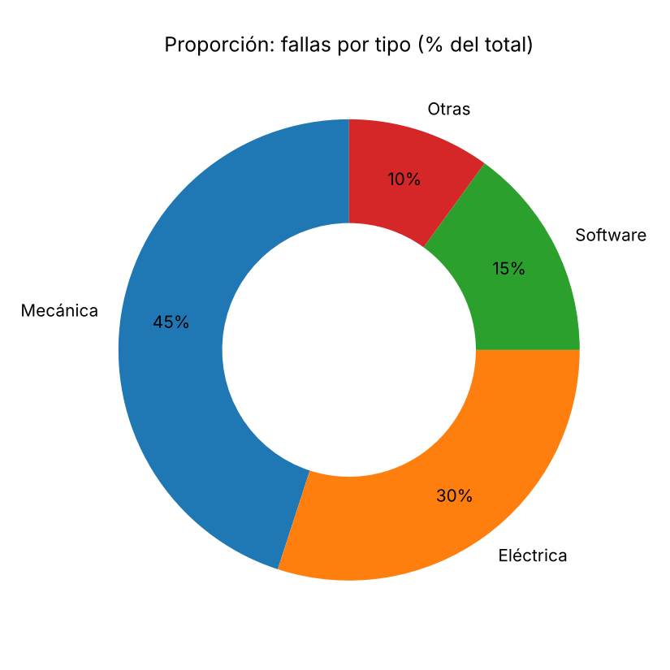
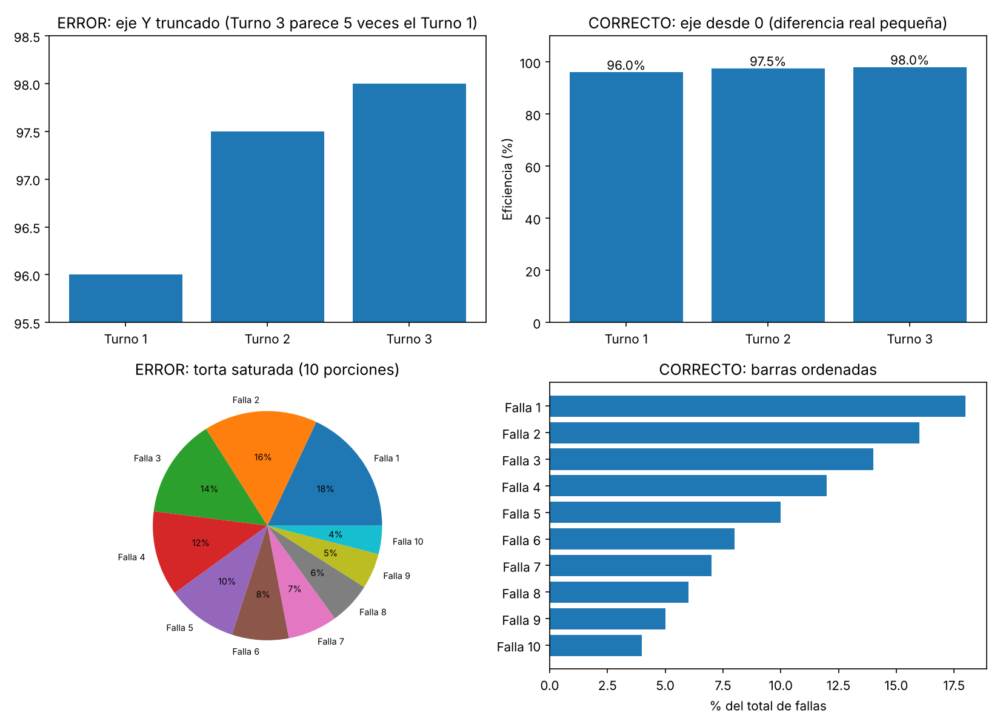

# Parcial práctico · Corte 3 (Semana 15)

**Estudiante:** Cristian Camilo Quiguanas Ossa
**Usuario de GitHub:** Camilo231106
**Electiva:** Ciencia de Datos (2026-B)

## Contenido de la carpeta

| Archivo | Descripción |
|---|---|
| `generar_datos.py` / `serie.csv` | Serie de ejemplo: producción diaria de una línea de ensamblaje (2023-2025) |
| `problema1.py` | Carga, `resample`, media móvil, tendencia y estacionalidad |
| `problema2.py` | Gráficos correctos para 3 preguntas y corrección de errores de diseño |
| `problema3.sql` | Consulta lenta vs. optimizada |
| `medidas.dax` | Medidas DAX |

Ejecución: `pip install pandas numpy matplotlib` y luego `python generar_datos.py`, `python problema1.py`, `python problema2.py`.

---

## Problema 1 · Serie de tiempo

**Procedimiento**
1. **Carga:** `pd.read_csv(..., parse_dates=["fecha"], index_col="fecha")` deja un `DatetimeIndex`, requisito para usar `resample` y operaciones temporales.
2. **Agregación:** `resample("ME").mean()` convierte la serie diaria (1096 datos) en mensual (36 datos).
3. **Media móvil:** `rolling(3)` suaviza el ruido; `rolling(12)` promedia un ciclo anual completo, por lo que elimina la estacionalidad y deja ver la tendencia.
4. **Descomposición aditiva:** `observado = tendencia + estacionalidad + residuo`. La tendencia es una media móvil centrada 2x12; la estacionalidad es el promedio por mes de (observado − tendencia).




**Interpretación**
- **Tendencia: creciente.** La media móvil de 12 meses sube de forma sostenida y la regresión lineal da una pendiente de **≈ 10.7 unidades/mes (≈ 128 por año)**.
- **Estacionalidad: anual (periodo = 12 meses).** El patrón se repite cada año: **pico en julio (≈ +58 unidades sobre la tendencia)** y **valle en diciembre (≈ −59)**. Ene, Feb y Dic están por debajo de la tendencia; May-Ago, por encima.
- **Residuo:** variación aleatoria pequeña frente a los otros dos componentes, lo que indica que el modelo aditivo describe bien la serie.

---

## Problema 2 · Visualización

### 2a. Gráfico correcto para cada pregunta

| Pregunta | Gráfico | Justificación |
|---|---|---|
| **Evolución:** ¿cómo cambió la producción mensual? | **Líneas** | El eje X es el tiempo; la línea muestra continuidad, tendencia y picos. |
| **Comparación:** ¿qué línea produjo más en 2025? | **Barras horizontales ordenadas** | La longitud se compara con precisión entre categorías; el orden facilita el ranking. |
| **Proporción:** ¿qué % del total de fallas aporta cada tipo? | **Dona / torta (≤ 5 categorías)** | Muestra la parte frente al todo (suma 100%). Con más categorías se cambia a barras. |





### 2b. Errores de diseño y corrección



1. **Eje Y truncado (barras).** Con el eje desde 95.5, el Turno 3 (98%) parece unas 5 veces el Turno 1 (96%), cuando la diferencia real es de 2 puntos. Las barras codifican el valor con su **longitud**, y truncarla exagera las diferencias.
   **Corrección:** eje desde 0 y etiquetas de valor.
2. **Torta saturada (10 porciones).** Colores similares y ángulos parecidos hacen que el ojo no pueda comparar porciones pequeñas.
   **Corrección:** barras horizontales ordenadas de mayor a menor (o agrupar las menores en "Otros").

---

## Problema 3 · Optimización y métricas

### 3a. Consulta optimizada (ver `problema3.sql`)

```sql
-- Lenta
SELECT * FROM ventas WHERE YEAR(fecha) = 2026 AND MONTH(fecha) = 10;

-- Optimizada
CREATE INDEX idx_ventas_fecha ON ventas (fecha);
SELECT id_venta, fecha, id_cliente, monto
FROM ventas
WHERE fecha >= '2026-10-01' AND fecha < '2026-11-01';
```

**Por qué mejora**
1. **Solo las columnas necesarias:** se leen y transfieren menos datos (disco, memoria, red) y el índice puede cubrir la consulta.
2. **Filtro por rango, sin funciones sobre la columna:** `YEAR(fecha)` se calcularía fila por fila e impide usar el índice (condición no *sargable*). Comparar `fecha` con un rango sí lo permite.
3. **Índice sobre `fecha`:** el motor busca en un árbol B (O(log n)) y salta a las filas de octubre, en lugar de un *full table scan* (O(n)). Se verifica con `EXPLAIN` (Seq Scan → Index Scan).
4. **Costo:** el índice ocupa espacio y ralentiza INSERT/UPDATE; se crea solo sobre columnas muy filtradas.

### 3b. Medidas DAX (ver `medidas.dax`)

```DAX
Total Ventas = SUM ( Ventas[Monto] )

% del Total =
DIVIDE ( [Total Ventas], CALCULATE ( [Total Ventas], ALL ( Ventas ) ) )
```

Adicionales: `Ventas Año Anterior` (con `SAMEPERIODLASTYEAR`) y `Variación vs Año Anterior %`.

### Diferencia entre medida y columna calculada

| | **Medida** | **Columna calculada** |
|---|---|---|
| Cuándo se calcula | Al consultar, según los filtros del visual (contexto de filtro) | Al cargar o actualizar el modelo, fila por fila (contexto de fila) |
| Almacenamiento | No guarda datos | Guarda el resultado en la tabla (usa memoria) |
| Reacciona a segmentadores | Sí | No |
| Uso típico | Totales, %, KPIs | Categorías, etiquetas, valores por fila (ej. `Margen = Precio − Costo`) |

---

## English requirement (Problem 3)

An **index** speeds up a query because the database can jump straight to the matching rows, like a book's index, instead of scanning the whole table row by row. A **measure** in Power BI is a DAX calculation that is evaluated at query time and responds to the filters and slicers in the report. Unlike a calculated column, it does not store a value in every row.
